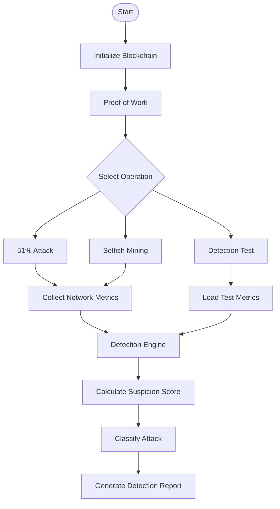
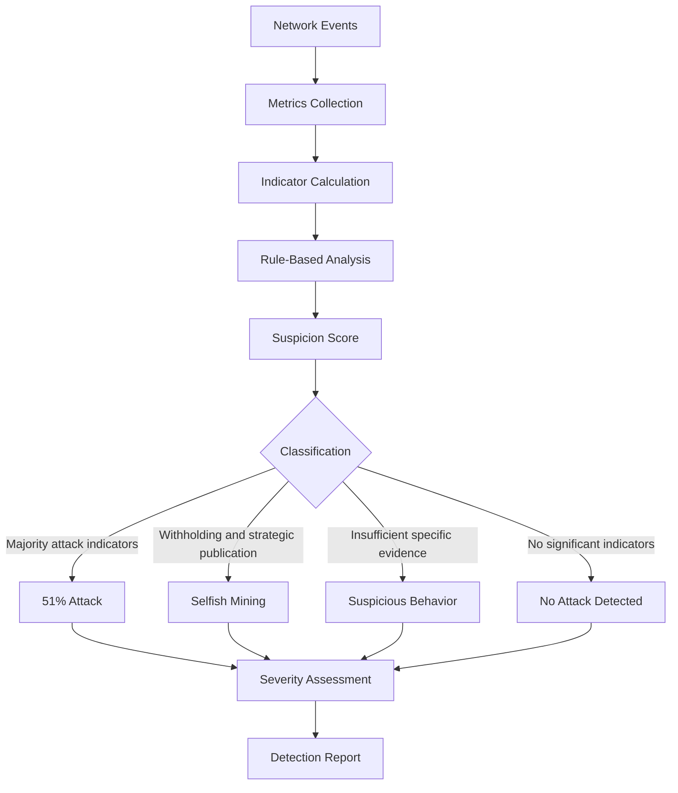

# ⛓️ Blockchain Security Lab
### From-Scratch Blockchain Implementation & Attack Simulation in C

<p align="center">
  <strong>Exploring blockchain security through practical implementation, attack simulation, and rule-based detection.</strong>
</p>

<p align="center">
  
  
  
  
  
  
  
  
</p>

---

##  Overview

**Blockchain Security Lab** is an educational project developed in C to explore the internal mechanisms of blockchain technology and investigate vulnerabilities in Proof of Work (PoW) consensus systems.

The project implements a simplified blockchain from scratch and simulates two major blockchain attacks:

- **51% Attack** — exploiting majority mining power to reorganize the blockchain and potentially perform double-spending.
- **Selfish Mining** — strategically withholding and publishing blocks to gain an unfair mining advantage.

A rule-based detection engine analyzes network metrics and identifies suspicious mining behaviors.

The goal is to understand not only how blockchain attacks work, but also how their effects can be observed and detected.


##  Key Features

<table>
<tr>
<td width="50%">

### 🔗 Blockchain Core
- Block creation and validation
- SHA-256 hashing
- Previous-block hash linking
- Proof of Work mining
- Chain integrity verification

</td>
<td width="50%">

### ⚔️ Attack Simulation
- 51% Attack
- Selfish Mining
- Private and public chains
- Fork creation
- Chain reorganization
- Orphan block tracking

</td>
</tr>
<tr>
<td width="50%">

### 🛡️ Detection Engine
- Rule-based attack detection
- Suspicion scoring
- Attacker block share
- Orphan rate calculation
- Reward distribution analysis
- Propagation delay monitoring

</td>
<td width="50%">

### 📊 Experimental Analysis
- Mining statistics
- Fork and reorganization tracking
- Attack classification
- Severity assessment
- Comparative scenarios

</td>
</tr>
</table>

##  Project Architecture

The project is organized into modular C source files, separating blockchain operations, attack simulations, and security analysis.

```text
Blockchain-Security-Lab/
│
├── main.c
│
├── blockchain.c
├── blockchain.h
│
├── attack_51.c
│
├── selfish_mining.c
│
├── detection.c
├── detection.h
│
├── README.md
└── .gitignore
```

### System Workflow



##  Implemented Attacks

### 1. 51% Attack

A 51% Attack occurs when a malicious miner or mining pool controls more than half of the network's total mining power.

This simulation demonstrates:

- Competition between honest and attacker chains.
- Private alternative chain construction.
- Strategic publication of the attacker's chain.
- Chain reorganization.
- Double-spending illustration.

**Example configuration:**

| Parameter | Value |
|---|---:|
| Honest mining power | 40% |
| Attacker mining power | 60% |
| Consensus mechanism | Proof of Work |

<details>
<summary><strong>📊 Observed detection result</strong></summary>

| Metric | Result |
|---|---:|
| Attacker block share | 60% |
| Orphan rate | 33.33% |
| Forks | 1 |
| Reorganizations | 1 |
| Double-spending events | 1 |
| Detection score | 14 |
| Severity | Critical |

**Classification:** `51% Attack`

</details>

### 2. Selfish Mining

Selfish Mining is a strategic attack in which a miner privately retains discovered blocks instead of immediately broadcasting them.

The simulation explores:

- Private chain construction.
- Strategic block publication.
- Mining advantage management.
- Fork creation and resolution.
- Gamma parameter influence.
- Orphan block generation.

**Example configuration:**

| Parameter | Value |
|---|---:|
| Honest mining power | 60% |
| Attacker mining power | 40% |
| Gamma | 50% |
| Simulation rounds | 20 |

<details>
<summary><strong> Observed detection result</strong></summary>

| Metric | Result |
|---|---:|
| Attacker block share | 50% |
| Orphan rate | 33.33% |
| Forks | 4 |
| Reorganizations | 2 |
| Average propagation delay | 300.79 ms |
| Detection score | 8 |
| Severity | High |

**Classification:** `Selfish Mining`

</details>

*Note: These are observed results from a particular simulation run, not universal attack performance measurements.*

##  Detection Engine

The detection module uses a **Rule-Based Detection System** to analyze blockchain activity.

It collects metrics, calculates statistical indicators, assigns suspicion points, and classifies potential attacks.

### Monitored Metrics

| Metric | Purpose |
|---|---|
| Attacker Block Share | Measures the attacker's proportion of mined blocks |
| Orphan Rate | Measures the proportion of orphaned blocks |
| Withheld Blocks | Tracks attacker blocks retained privately |
| Strategic Publications | Tracks strategic block publication |
| Forks | Detects competing blockchain branches |
| Reorganizations | Tracks changes to the canonical chain |
| Chain Inconsistencies | Identifies blockchain inconsistencies |
| Double Spending | Tracks double-spending events |
| Reward Share | Measures the attacker's proportion of rewards |
| Propagation Delay | Measures simulated block propagation time |

### Detection Pipeline



### Severity Levels

| Suspicion Score | Severity |
|---|---|
| 0–2 | 🟢 Low |
| 3–5 | 🟡 Moderate |
| 6–8 | 🟠 High |
| 9+ | 🔴 Critical |

##  Experimental Results

The following table summarizes the observed classification results:

| Experiment | Attacker Power | Detection Result | Score | Severity |
|---|---:|---|---:|---|
| 51% Attack | 60% | 51% Attack | 14 | Critical |
| Selfish Mining | 40% | Selfish Mining | 8 | High |

These experiments demonstrate that the detection engine can distinguish the two implemented attack scenarios under the tested configurations.

##  Technologies Used

<p>
  
  
  
  
  
</p>

- **C:** Core implementation and simulation logic.
- **GCC:** Compilation.
- **OpenSSL:** Cryptographic hashing.
- **SHA-256:** Block hash generation and integrity verification.

##  Getting Started

### Prerequisites

Make sure you have:

- GCC compiler.
- OpenSSL development libraries.
- A terminal or C development environment.

### 1. Clone the repository

```bash
git clone https://github.com/YOUR_USERNAME/YOUR_REPOSITORY.git
```

### 2. Navigate to the project directory

```bash
cd YOUR_REPOSITORY
```

### 3. Compile the project

```bash
gcc main.c blockchain.c attack_51.c selfish_mining.c detection.c -o blockchain.exe -lcrypto
```

### 4. Run the application

On Windows PowerShell:

```powershell
.\blockchain.exe
```

On Linux:

```bash
./blockchain
```

##  Application Menu

The application provides an interactive terminal menu:

```text
=================================
      BLOCKCHAIN FROM SCRATCH
=================================

1. Blockchain PoW
2. Blockchain PoS
3. Simuler une attaque 51%
4. Simuler Selfish Mining
5. Tester le module de detection

Votre choix :
```

Select an option to execute the corresponding operation and inspect the generated output.

##  Limitations

This project is an educational simulation and does not represent a production-ready blockchain implementation.

Current limitations include:

- Simplified network and miner behavior.
- Simulated propagation delays rather than real network measurements.
- Rule-based detection with predefined thresholds.
- Limited experimental configurations and simulation repetitions.
- Reward-accounting inconsistencies that require further validation.
- No comprehensive statistical evaluation of false positives and false negatives.

The experimental results should therefore be interpreted within the assumptions of the implemented simulation.

##  Future Improvements

Potential extensions include:

- [ ] Improve reward and orphan-block accounting.
- [ ] Add normal-network scenarios and false-positive testing.
- [ ] Run experiments with different attacker hash rates.
- [ ] Study the influence of different Gamma values.
- [ ] Add statistical evaluation across repeated simulations.
- [ ] Calculate precision, recall, and false-positive rate.
- [ ] Implement and evaluate countermeasures.
- [ ] Add graphical visualization of experimental results.

##  Academic Context

This project was developed as part of a practical academic assignment focused on blockchain security, consensus mechanisms, attack simulation, and detection.

It aims to provide a hands-on understanding of how vulnerabilities in Proof of Work systems can be exploited and how suspicious behaviors can be identified through network metrics.

---
<p align="center">
  <strong>Created by : Ouaraghouane Nour El houda :)</strong>
</p>
<p align="center">
 Built with C, curiosity, and a little cryptographic chaos. ⛓️
</p>
